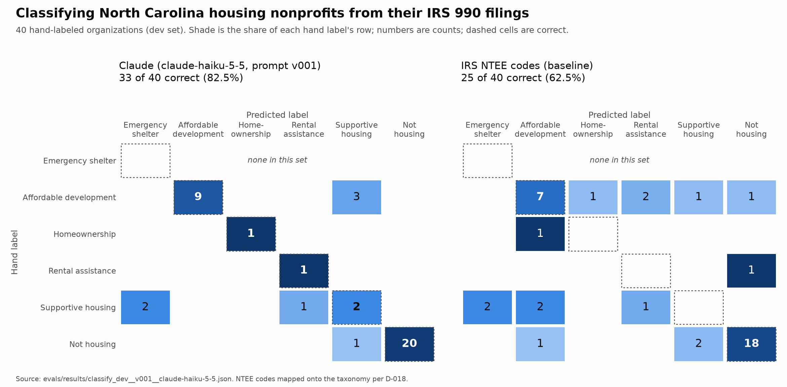
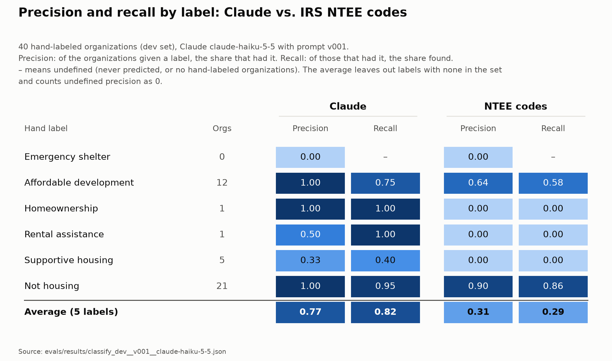

# NC Housing Nonprofit Landscape

**A technical prototype showing how Claude can read IRS Form 990 filings to find the nonprofits working on an issue, so funders can see the full landscape before they write a strategy or an RFP.**

> **Status: in progress (started November 2026).** Stage 1 (classification and eval) runs end to end on a 40-organization dev set, with one prompt version (v001). The 60-organization test set hasn't been scored yet. Stage 2 (landscape agent) is planned. No numbers in this README are estimates; every figure comes from saved eval output.

---

## At a glance

| | |
|---|---|
| **The problem** | Funders map the nonprofits in their area from relationships and word of mouth, which misses organizations without the capacity to court funders. |
| **What I built** | A pipeline that pulls North Carolina housing nonprofits' 990 filings, has Claude classify each one into a specific type of housing work, and evaluates Claude against hand labels and against the IRS's own subject codes (NTEE). |
| **First result (dev set)** | Claude labeled 33 of 40 organizations correctly (82.5%). NTEE codes got 25 of 40 (62.5%), and never correctly identified homeownership, rental assistance, or supportive housing organizations. |
| **What it shows** | Scoping a real nonprofit-sector problem into a measurable AI use case, designing an honest eval with a baseline, and building a working prototype with Claude Code. |
| **What it doesn't show** | My ability to hand-write Python, or a finished client-facing product. See [What I'm claiming](#what-im-claiming-and-what-im-not). |

<picture>
  <source media="(prefers-color-scheme: dark)" srcset="docs/images/confusion_dev_v001_dark.png">
  
</picture>

---

## The problem

Foundations increasingly want system-wide strategies: funding a set of organizations that together address an issue like housing across a region, not just one grantee at a time. To do that, they need to know who is doing the work.

There is no standardized, complete list of the nonprofits working on a given issue. So funders rely on institutional and "street" knowledge: who has applied before, who board members know, who shows up at convenings. That picture is incomplete in a predictable way. It misses the organizations with the fewest resources to engage with philanthropy, the ones without a development director, a grant writer, or time to network. They are often the ones a system-wide strategy most needs to reach.

The public data to start filling that gap already exists. Every e-filed Form 990 is released by the IRS. But it is hard to use:

- **The IRS's subject codes are unreliable.** Nonprofits are tagged with National Taxonomy of Exempt Entities (NTEE) codes, and housing falls under major group L. Those codes are coarse, often out of date, and sometimes wrong. Some organizations coded as housing aren't housing organizations, and some housing organizations (community development corporations, for example) are coded elsewhere.
- **The useful detail is in free text.** What an organization actually does is in its mission statement and program service descriptions, not in a code.
- **The raw data is heavy.** Filings come as XML in large zipped monthly partitions.

Most foundations and nonprofits don't have the data staff to work through this.

## The solution: Claude reads the filings

Claude reads each organization's mission and program descriptions from its 990 and classifies the work it actually does, at a finer grain than NTEE codes allow. For a funder, that means:

- **Finding the right organizations before an RFP is written.** Strategy can be built around who is actually doing the work, not just who is already known.
- **Seeing blind spots in current giving.** Comparing the full landscape against the current grantee list shows which types of work, and which organizations, a portfolio is missing.
- **Optimizing the portfolio.** With a consistent classification, funders can see where their giving is concentrated and where it is thin.

The project measures how well this works instead of assuming it does: every classification is scored against hand labels, next to the NTEE codes funders use today. Stage 2 adds an agent that answers landscape questions in plain language, with every number traceable to a database query.

---

## What I'm claiming, and what I'm not

**This project is:**
- **A technical prototype** of an applied AI use case for philanthropy and nonprofits.
- **A demonstration of LLM engineering concepts:** a fixed taxonomy with structured, validated output; versioned prompts; cached, reproducible API calls; a hand-labeled eval with a dev/test split; a baseline to beat; and error analysis that drives prompt changes.
- **A demonstration of how an LLM can solve a real-world problem** in a sector I work in, scoped from a funder's actual question to a measurable result.
- **A demonstration of building with Claude Code:** directing an AI coding agent through a multi-stage data pipeline, with project rules (`CLAUDE.md`), hooks, tests, and a decision log that keep the work consistent and auditable. I scoped the problem, designed the taxonomy and the eval, wrote every hand label, made and logged the design decisions, and reviewed the work.

**This project is not:**
- **A demonstration of my hand-written Python.** Claude Code wrote most of the code under my direction. I worked in Python with IRS data, including Form 990 filings, at Deloitte (2017–2019); my work since then has been mostly in R. I read and reviewed the code here, and I write Python with documentation at hand.
- **A finished, client-facing product.** There is no user interface, the eval set is small, and results haven't been reviewed with funders.
- **A complete census of housing organizations.** It sees only organizations that file a full 990 or 990-EZ. The smallest nonprofits file the 990-N postcard, which has no mission or program text, so some of the least-resourced organizations described above are still invisible here. Closing that gap would need other data sources.

**What I did, specifically**
- Framed the problem from my work with funders and nonprofits, and chose housing in North Carolina as a narrow, checkable first case.
- Designed the six-label housing taxonomy and the labeling guide.
- Hand-labeled 100 organizations, blind to their NTEE codes.
- Designed the eval: a stratified sample, a dev/test split so prompt tuning can't inflate the final score, and NTEE as the baseline.
- Made and documented the design decisions (`docs/decisions.md`), including data rules, deduplication, the NTEE-to-taxonomy mapping, and keeping all arithmetic out of the model.
- Directed Claude Code to build the pipeline, the classifier, and the eval, and reviewed its output.

---

## Results so far

### Stage 1: classification (dev set, prompt v001)

40 hand-labeled organizations, Claude model `claude-haiku-5-5`, first prompt version. Source: [`evals/results/classify_dev__v001__claude-haiku-5-5.json`](evals/results/classify_dev__v001__claude-haiku-5-5.json).

| | Correct | Avg. precision | Avg. recall |
|---|---|---|---|
| **Claude** | 33 of 40 (82.5%) | 0.77 | 0.82 |
| **NTEE codes** | 25 of 40 (62.5%) | 0.31 | 0.29 |

*Averages cover the five labels present in the dev set. Undefined precision counts as 0.*

<picture>
  <source media="(prefers-color-scheme: dark)" srcset="docs/images/precision_recall_dev_v001_dark.png">
  
</picture>

**What the dev set shows**
- **NTEE codes can't separate types of housing work.** They scored zero on homeownership, rental assistance, and supportive housing. That finer grain is the distinction a funder needs.
- **Claude's errors cluster around supportive housing.** Three affordable housing developers were labeled supportive housing; of five supportive housing organizations, two were labeled emergency shelter and one rental assistance. The line between housing with services and housing alone is where the next prompt version will focus (`docs/error_analysis.md`).
- **Claude rarely confuses housing with non-housing.** 20 of 21 non-housing organizations were labeled correctly.

**How much to trust these numbers**
- **The sample is small.** Several labels have one or two organizations (one homeownership, one rental assistance, none for emergency shelter), so per-label scores can swing with a single case.
- **These are dev-set numbers.** The dev set guides prompt work, so it will flatter later prompt versions. The 60-organization test set will be scored once, with the final prompt, and those are the numbers to cite.
- **One labeler.** The hand labels reflect my judgment, following a written guide.

### Stage 2
*Pending.* Will report: grounding-check pass rate and benchmark question results.

---

## How it works

### Stage 1: Housing classifier and eval

Claude reads each organization's mission and program service descriptions from its 990 and assigns it to one housing category:

| Label | Meaning |
|---|---|
| `emergency_shelter` | Emergency or short-term shelter |
| `affordable_housing_development` | Builds, owns, or operates affordable housing |
| `homeownership` | Homebuyer assistance, counseling, self-help building |
| `rental_assistance` | Rent relief, eviction prevention |
| `supportive_housing` | Housing combined with services (disability, recovery, youth, seniors) |
| `not_housing` | Housing is not a primary purpose |

*The taxonomy was reviewed after the 40 dev labels and kept unchanged (D-017). It is strict on primary purpose: an organization gets a housing label only if housing is its main work, judged by program spending and then mission. Organizations doing real housing work outside their primary purpose, such as advocacy groups or multi-service agencies, are labeled `not_housing`. The 990 text also limits what any label can see. Widening the taxonomy is a tradeoff to discuss with whoever uses the results, and any change will be logged in `docs/decisions.md`.*

**The eval.** A hand-labeled set of 100 North Carolina organizations: 40 that NTEE codes as housing (L), 30 coded in adjacent human services and community development categories, and 30 random. It is split into a 40-organization dev set for prompt work and a 60-organization test set for reporting. Hand labeling is blind to NTEE codes and follows [`evals/labels/labeling_guide.md`](evals/labels/labeling_guide.md) (D-015).

Claude's labels and the NTEE codes are both compared to the hand labels. **The baseline to beat is NTEE**, mapped onto the same taxonomy (D-018). Hand labels are never changed to match model output; any label change gets an entry in `docs/decisions.md` saying why.

**How the classifier stays reproducible**
- **Versioned prompts.** Prompts live in `src/classify/prompts/` as numbered files (`v001.md`, `v002.md`, ...). Changing a prompt means adding a new version, never editing an old one. Each version writes out the label definitions as XML categories, following Anthropic's [classification cookbook](https://platform.claude.com/cookbook/capabilities-classification-guide), so a cached response always maps to the definitions it was given (D-016).
- **Cached responses.** Every API response is saved as JSONL in `data/interim/api_cache/`, keyed by EIN, prompt version, and model. Reruns read from the cache unless `--refresh` is passed, so an eval can be reproduced without paying for the same calls twice.
- **Validated output.** Claude returns one label from the fixed taxonomy plus a short reason. Anything outside the taxonomy is logged as an error, not coerced into a label.

### Stage 2: Landscape agent *(planned)*

A Claude agent that answers landscape questions in plain language, e.g. *"Which organizations in the Cape Fear region provide supportive housing, and how has their revenue changed?"*

- Claude gets one tool: a **read-only SQL tool** over the cleaned 990 database, which includes the Stage 1 labels. It uses a read-only DuckDB connection, allows `SELECT` statements only, and caps results at 500 rows.
- It writes a short brief: who is active, their size, revenue trends, funding mix, and visible gaps.
- **All arithmetic happens in SQL. Claude never calculates figures itself.** Every number in a brief must come from a query result.
- Every query the agent runs is saved alongside its brief.

**The eval.** An automated grounding check uses the saved query log to verify that every number in a brief appears in the results of a query the agent actually ran. A small set of benchmark questions with known answers checks coverage.

---

## Data

| Source | What it provides | Link |
|---|---|---|
| IRS Form 990 series e-file (XML) | Financials, mission, and program descriptions. Monthly zipped partitions with an index CSV for each year. | [IRS Form 990 series downloads](https://www.irs.gov/charities-non-profits/form-990-series-downloads) |
| IRS Exempt Organizations Business Master File (EO BMF) | EIN, name, address, NTEE code. CSV by state. | [IRS EO BMF](https://www.irs.gov/charities-non-profits/exempt-organizations-business-master-file-extract-eo-bmf) |

**Pipeline.** BMF (North Carolina) → candidate EIN list → join to the yearly index CSVs, drop 990-T returns, and keep the latest filing per EIN and tax period by `OBJECT_ID` (D-010) → extract *only* those XML files, finding each one by the zips' file lists rather than the index's batch ID (D-011) → parse with `lxml` into filing, program, revenue-line, and Schedule O tables (D-012, D-013) → load into DuckDB, in an `ingest` schema that each build replaces atomically, next to the `classify` and `agent` schemas it never touches (D-014; tables in `docs/schema.md`).

**Data conventions**
- **EINs are strings.** They are always 9 digits, zero-padded, and never cast to integers (casting would drop leading zeros).
- **Dollar amounts are whole dollars**, stored as `BIGINT`.

**Known limitations of the data**
- **Lag.** Filings run one to two years behind.
- **Small organizations are missing.** Organizations that file the 990-N postcard report no financials or mission text.
- **Location is headquarters, not service area.** BMF addresses generally reflect where an organization is headquartered, which may not be where it works.
- **Grant data has gaps.** Some foundation and grant data is missing from the IRS XML releases ([Aspen Institute comments to the IRS, 2025](https://www.aspeninstitute.org/wp-content/uploads/2025/11/IRS-Comments-2025-Form-990-Series.pdf)).
- **Year folders reflect processing date, not tax year.** A tax year can span two folders.

---

## Tech stack

- **Python** for everything
- **Anthropic Python SDK** ([docs](https://docs.claude.com)) for classification and the agent's tool use
- **lxml** to parse the XML; **pandas** for data handling; **DuckDB** as the analytical database
- **pytest** for pipeline tests
- **Claude Code** to build the project, guided by `CLAUDE.md` and a Ruff hook that formats and lints every file it edits

The model name, all file paths, and other settings live in `config.yaml`, so nothing is hardcoded and results can be rerun on newer models and compared.

---

## Repository layout

```
├── README.md
├── CLAUDE.md               # Instructions for Claude Code when working in this repo
├── config.yaml             # Model, paths, sample sizes
├── pyproject.toml          # Package metadata, Ruff and pytest config
├── data/                   # Not committed (raw IRS files are large)
│   ├── raw/                # BMF CSV, index CSVs, zip partitions
│   ├── interim/            # Extracted XML subset
│   │   └── api_cache/      # Cached Claude API responses (JSONL)
│   └── processed/          # DuckDB database (schemas: ingest, classify, agent)
├── src/
│   ├── ingest/             # BMF filter, index join, selective unzip, XML parse, DB build, quality report
│   ├── classify/           # Claude API calls, label output
│   │   └── prompts/        # Versioned prompts (v001.md, v002.md, ...)
│   └── agent/              # SQL tool, agent loop, brief writer (planned)
├── evals/
│   ├── labels/             # Hand-labeled set (CSV) and labeling guide
│   ├── results/            # Saved eval output (source of all reported numbers)
│   ├── classify_eval.py    # Claude vs. hand labels vs. NTEE (and a random floor)
│   ├── ntee_taxonomy_map.csv  # NTEE code → taxonomy label, for the baseline (D-018)
│   └── agent_eval.py       # Numeric grounding and benchmark questions (planned)
├── docs/
│   ├── decisions.md        # Design choices and why
│   ├── schema.md           # Database tables, keys, and owners
│   ├── field_map.md        # 990 / 990-EZ XML paths parsed
│   ├── error_analysis.md   # What Claude got wrong and what changed
│   └── images/             # Result charts
└── tests/
    └── fixtures/           # Small sample files for tests (never real data/)
```

---

## How to run

```bash
# 1. Install
pip install -e ".[dev]"
# Also install 7-Zip (https://www.7-zip.org) and put it on PATH or in its
# default folder. A few IRS zips use Deflate64, which Python can't decompress
# (D-011).

# 2. Set your API key: copy .env.example to .env (gitignored) and fill it in,
#    or set it in the shell, which wins over .env
cp .env.example .env
export ANTHROPIC_API_KEY=...              # bash / zsh
$env:ANTHROPIC_API_KEY = "..."            # PowerShell

# 3. Put the IRS files in data/raw/ (see Data above)

# 4. Build the database, then check the funnel and missing fields
python -m src.ingest.build
python -m src.ingest.quality

# 5. Draw the labeled sample, ingest it, and write the blank labeling sheets
python evals/make_sample.py draw
python -m src.ingest.build
python evals/make_sample.py sheet

# 6. Classify, evaluate, and draw the charts
python -m src.classify.run                # add --refresh to bypass the API cache
python evals/classify_eval.py
python -m evals.plot_confusion
```

The API key is read from the environment, which the command-line scripts first fill from a gitignored `.env` file if one exists. It is never written to code, config, logs, or output.

---

## Development

- **Python 3.12.**
- **Ruff** for formatting and linting (Black-compatible, line length 88, rules `E`, `F`, `I`, `UP`, `B`, `SIM`). Config is in `pyproject.toml`. A Claude Code hook runs Ruff on every file Claude edits, and a git pre-commit hook runs it again before every commit.
- **pytest** for tests. Tests use small fixture files in `tests/fixtures/`, never files from `data/`, so ingest steps can be tested without the real IRS files.

```bash
ruff format . && ruff check --fix .            # format and lint
pytest                                         # run all tests
pytest tests/test_<module>.py::test_<name>     # run a single test
```

---

## Design choices

- **Measure against the existing tool, not against nothing.** NTEE is what people use today, so it's the baseline.
- **Tune on dev, report on test.** Prompt changes are judged on the dev set only; the test set is scored once at the end.
- **Keep math out of the model.** SQL computes the numbers; Claude explains them. That makes every figure traceable.
- **Read-only access.** The agent's database connection can't modify data, and results are capped at 500 rows.
- **Reproducible by default.** Cached responses and versioned prompts mean an eval can be rerun without new API calls or silent prompt drift.
- **Start narrow.** One subsector and one state, so the hand-labeled set can be checked carefully.
- **Decisions are logged, not rewritten.** Every real design choice gets an entry in `docs/decisions.md`. Accepted entries are never edited; a later entry supersedes them.

---

## Limitations of this project

- **One labeler.** I wrote the hand labels myself, and they reflect my judgment. The labeling guide is in `evals/labels/` so others can check or extend it.
- **Small eval set.** 100 organizations is enough to show patterns, not to give tight error bars.
- **Only full 990 and 990-EZ filers.** The smallest organizations aren't covered (see above).
- **Public data only.** 990s describe what organizations report, not outcomes.

---

## About

Built by Danté Haywood, Director of Data Science at Cape Fear Collective in Wilmington, NC, where I lead technical scoping and delivery for data projects with foundations and nonprofits. Built independently on personal time with public data; not a Cape Fear Collective project.

**How AI was used.** I scoped the project, designed the taxonomy and the eval, wrote the hand labels, and made the design decisions. Claude Code wrote most of the code under my direction, and I reviewed it. Claude, through the API, is the subject of the evals.
